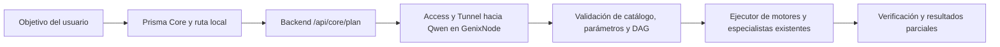

# Queen — transferencia completa y misión de finalización

**Este documento es la entrada principal para otra cuenta de Codex. La transferencia conserva el trabajo; Queen sigue en desarrollo y no está terminada.** No comenzar de cero, repetir auditorías, pedir capturas pasivas ya recibidas ni ejecutar comandos históricos por el hecho de encontrarlos en un informe.

Se preparó desde el checkpoint remoto real **`732bce69297a092008b68f1a0439592cb90173ed`**, posterior a `6673124`. El workspace de transferencia estaba limpio en `6673124` y se actualizó mediante fast-forward, conservando `2b8fc19`, `25a9c9e`, `2fd9008` y `732bce6`. No hubo reset, rebase, descarte de cambios, inferencia, lector del VPS, reinstalación o intervención de servidor durante esta transferencia.

## 1. Identidad, procedencia y autoridad del estado

| Elemento | Estado que debe recuperarse |
| --- | --- |
| Repositorio | `AndresYepez23/PRISMA`, https://github.com/AndresYepez23/PRISMA |
| Rama de trabajo | `feature/prisma-neural-genixnode-qwen35-pilot` |
| PR | [#125](https://github.com/AndresYepez23/PRISMA/pull/125): abierto, **draft**, sin fusionar; mantener así durante la recuperación y validación |
| Código, lectores y evidencia anteriores al handoff | `732bce69297a092008b68f1a0439592cb90173ed` |
| Commit que contiene esta transferencia | Obtenerlo del historial de este archivo: `git log -1 --format='%H %s' -- prisma/docs/QUEEN-HANDOFF.md`; el PR y la entrega final registran su SHA completo. Un documento no puede incorporar el hash de su propio commit sin cambiarlo |
| Último despliegue aislado comprobado | **`16436df0-3d50-4e89-9165-b875be731d3f`**, https://16436df0.prisma-queen-staging.pages.dev, Production del proyecto aislado |
| Fuente de ese despliegue | **`ed94e25b9f38645a484c740f9f2e3ac3063f3a4f`**, `commit_dirty=false`; **no representa HEAD ni las correcciones posteriores de presupuesto** |

Orden de autoridad: este handoff y el bloque vigente de [QUEEN-CONTINUITY.md](QUEEN-CONTINUITY.md), luego [residencia/diagnóstico más reciente](queen-genix-residency-2026-11-13.md), después la evidencia concreta. El [índice](QUEEN-INDEX.md) clasifica todo el material. Los informes históricos conservan su contexto: «sin mediciones», «sin inferencias», «publicación pendiente» o «ejecutar una captura» pueden estar superados. El archivo de arquitectura inicial también es histórico; no sustituye el estado de este documento.

## 2. Objetivo de Queen y arquitectura actual

Queen es la inteligencia coordinadora de **Prisma Core**, dentro de Prisma Space. Debe comprender una solicitud, elegir herramientas/proveedores existentes, producir un plan válido, ejecutarlo bajo los permisos existentes, comprobar sus resultados y explicar con veracidad éxitos, resultados parciales y límites. No sustituye los motores ni se convierte en un agente con shell dentro de llama.cpp.

La ruta local existente conserva operaciones sencillas. Para semántica o composición, el navegador envía al backend la solicitud actual, metadatos de archivos y contexto procedimental acotado. El backend recupera contratos reales, consulta Qwen por Access/Tunnel y valida su JSON. El ejecutor de Prisma invoca motores existentes y un verificador independiente inspecciona resultados. Una propuesta no acredita ejecución y una firma válida no acredita contenido correcto.



El modelo recibe metadatos, **no los bytes del PDF ni una conversación privada completa**. No afirmar que leyó contenido que todavía no extrajo una herramienta. Las observaciones obtenidas de archivos deben ser acotadas e identificadas como datos no confiables antes de usarse para planificar; no inyectar respuestas esperadas ni celdas de referencia en el prompt. La coordinación neuronal completa con esos traspasos sigue pendiente de demostración.

## 3. Componentes implementados y estado real

Rutas de esta tabla relativas a `prisma/`. Consultar solo las necesarias para el siguiente fallo concreto, sin abrir otra auditoría general.

| Componente | Qué hace y por qué | Validación y límite actual |
| --- | --- | --- |
| `functions/_lib/queen.js` | Cliente exclusivo de backend, Access + Bearer, rutas permitidas, redirecciones bloqueadas, JSON acotado, tokenización real, límites y lease D1 | Autenticación e inferencias auténticas históricas; generación posterior bloqueada. Timeout incierto conserva cooldown; slot inactivo no significa generación sana |
| `functions/api/core/plan.js` | Combina análisis local, recuperación del catálogo, inferencia y corrección limitada por errores de validación | No omite composiciones porque el planificador antiguo encuentre una sola conversión. Correcciones posteriores necesitan regresión neuronal |
| `src/queen-contracts.js` | Proyecta herramientas de `registry.js` y parámetros de los mismos `tool-fields.js` de Explorar | No inventar IDs, campos o capacidades; incluye recuperación de operaciones flexionadas como «minifícalo» |
| `src/queen-schema.js`, `src/queen-plan.js` | Restringen estructura, intenciones, catálogo, parámetros, DAG, entradas, límites y preferencias | Sintaxis/validación no equivalen a comprensión; se rechazaron dimensiones inventadas, dependencias incorrectas y JSON literal alterado |
| `functions/_lib/queen-providers.js` | Proyección de proveedores, modalidades, salud, cuotas, modelos y selección manual/automática existentes | Disponibilidad anunciada no prueba inferencia ejecutada; no copiar claves de producción para llenar una prueba |
| `functions/_lib/queen-observations.js` | Distingue catálogo y observaciones reales por proveedor/modelo/modalidad | Un éxito de chat no acredita imagen, OCR o corrección semántica de un archivo |
| `src/queen-client.js` | Envía metadatos y referencias de procedimiento, sin secretos del servidor | Contexto acotado; archivos nuevos requieren su identidad y no autorizan reutilizar salidas anteriores |
| `src/core.js` | Integra Queen con conversación, aprobaciones, memoria, UI y motores existentes | El inicio de tarea se registra antes de planificar; se conservan rutas de respaldo. No es una nueva misión sobre Developer ni sobre el plugin de ChatGPT |
| `src/queen-execution.js` | Ejecuta DAG con `runToolBatch`/`runTool`, SHA-256 de entradas, idempotencia, resultados parciales y reparación limitada | Deadline absoluto compartido con planificación/reanudación. Reserva intento antes de reparar; respuesta tardía no ejecuta. Bytes o parámetros cambiados no reciben parciales de la entrada anterior. Herramientas opacas ya iniciadas pueden continuar internamente; resultado incierto no habilita reintento automático |
| `src/queen-handoff.js` | Adapta ZIP PNG de `pdf-to-image` a imágenes para `image-ocr`, con CRC y presupuestos | Motor y herramientas intactos; no se inventó OCR directo de PDF. Control determinista real pasó; cadena neuronal completa pendiente |
| `src/queen-verifier.js` | Verifica JSON/datos, formatos, hashes, PDF/páginas, dimensiones, Office/ZIP y recursos | DOCX/XLSX estructuralmente válidos pueden mantener comprobaciones semánticas pendientes; el harness inspecciona además contenido conocido |
| `neural-pilot/staging/worker.js`, `build.cjs`, `request.mjs` | Wrapper privado de pruebas, comprobación del marcador D1 y construcción aislada | No importado como activación pública de Queen. El builder compila, no despliega ni migra SQL |
| `evaluate.mjs` | Runner histórico de casos y controles autenticados, incluyendo smoke/composición JSON | Sus rutas smoke/compose pueden ejecutar motores JSON y verificador en el worker; las aserciones históricas de casos también se calculan allí. Las expectativas no entran en el prompt. Distinguir cada control de la cadena operacional que aún falta |
| `evaluate-quality.mjs`, `quality-evaluation.mjs` | Nueva evaluación de planificación, uso observado y pertinencia | Ocho originales y once nuevos preparados; rúbricas solo en evaluador cliente. Este runner no ejecuta motores ni acredita artefactos; revisión semántica pendiente |
| `browser-operations.cjs`, `operation-budget.mjs` | Archivos reales de contenido conocido, controles y pruebas operativas seleccionables | Fases OCR/normalización/Excel comparten presupuesto y se etiquetan como controles; caso de objetivo completo separado. Queen y especialistas se contabilizan por separado, uso incierto no se inventa |
| `monitor-vps.py`, `analyze-vps.py`, `probe-qwen.py` | Lectores manuales de recursos y sonda pequeña, con cobertura/errores explícitos | Lectores corregidos con pruebas offline. La sonda histórica ya venció; **no ejecutarla ahora ni pedir repetirla** |
| `inspect-vps-residency.py` y `VPS-RESIDENCY.md` | Lector pasivo acotado de proceso real, residencia, cgroups, ancestros, E/S y dispositivos | Captura ya recibida y verificada. Sus campos desconocidos siguen desconocidos; no volver a ejecutarlo por rutina |

La memoria sigue siendo procedimental, limitada y dentro del sistema de tareas existente. No se añadió entrenamiento externo, almacenamiento indiscriminado de chats, Qwen en navegador, shell, agentes o MCP dentro de llama.cpp. Se conservaron motores, proveedores, selección manual, rotación y mecanismos de respaldo del producto.

## 4. Modelo, configuración y presupuestos que se conservan

- Modelo: **`unsloth/Qwen3.5-2B-GGUF:Q4_K_M`**. Objetivo de conservar su calidad; no sustituirlo sin comparación justificada y autorización aplicable.
- Endpoint backend: `https://queen.prismaspace.space/v1`, a través de Access/Tunnel; llama.cpp local documentado en `127.0.0.1:7860`, contenedor `prisma-neural-qwen`. No abrir ese puerto públicamente ni recrear el túnel.
- Diseño de despliegue: Ubuntu 24.04 x86_64, CPU, dos vCPU/dos hilos declarados. Las capturas confirman dos CPU permitidas y RAM física de 3.82428 GiB; no convertir una declaración de `compose.yaml` en comprobación de todos los flags efectivos del servidor.
- Mantener contexto **2048**, salida máxima **256**, una inferencia concurrente, timeout de inferencia **55 s**, presupuesto de tarea **120 s**, hasta **ocho pasos y dos inferencias Queen**, con una reparación dentro del presupuesto restante.
- Lease D1 entre isolates. Límites públicos 5/min y 30/día; namespace privado del operador 12/min y 96/día. Ante inferencia incierta, cooldown de cinco minutos y comprobación de slot antes de otra inferencia. El cooldown no es permiso para repetir el mismo fallo sin información nueva.
- La sonda manual del VPS usa máximo ocho tokens, una completion, sin reintentos: generación 55 s, plazo global de sonda 100 s y plazos de metadatos acotados. Es distinto del presupuesto del runtime. No emplear `benchmark.py` histórico de varias peticiones/otro timeout para retomar.
- No elevar contexto, concurrencia, timeout o recursos por intuición. No crear checkpoints artificiales para eludir los presupuestos. Contabilizar especialistas aparte de Queen.

## 5. Infraestructura aislada, accesos y seguridad

Configuración/identidad verificadas por lectura de metadatos durante la transferencia, sin solicitudes a Qwen, SQL, despliegues o acceso SSH:

| Recurso | Identidad y restricción |
| --- | --- |
| Cuenta Cloudflare | `26c2a31382f903f4ce4f5f7bafbd6820` |
| Pages permitido | **`prisma-queen-staging`**, ID `4d1eca8d-7adb-4b5e-aa46-d39165633679`; validación en su entorno **Production**, no Preview |
| D1 permitida | **`980bad8f-0356-48b9-87bc-56bcf363f69a`**, binding `PRISMA_RATE_DB`; marcador `queen_staging_identity` ya creado |
| Configuración aislada | `prisma/wrangler.staging.toml`; proyecto Direct Upload, sin integración Git automática. Las migraciones previas y 0002/0003/0004 ya se aplicaron a la aislada: no repetirlas |
| Pages prohibido para desplegar/configurar | **`prismaspace`**, ID `c89b887d-199c-4a60-b9b5-58f743cc69dd` |
| D1 principal prohibida para escrituras/migraciones | **`e02104b5-0861-475a-a60f-7658439d4fe0`** |
| Producción principal observada | Canonical `67b3e7e7-16b2-43ec-9fc0-cb85a8adbc08`, main `4b24fe6d6f74375a337936aafe1199df9b1e9072`; trabajo ajeno conservado |

Los tres secretos `QUEEN_ACCESS_CLIENT_ID`, `QUEEN_ACCESS_CLIENT_SECRET`, `QUEEN_API_KEY` siguen presentes como `secret_text` en Production aislado. También existe `QUEEN_STAGING_KEY_SHA256`. **No solicitar de nuevo los tres secretos ni duplicarlos en Preview.** Presencia no significa que una cuenta nueva herede acceso ni que generación esté sana. Nunca incluir valores, tokens, claves SSH o `.env` en documentos, logs, argumentos o el chat.

La protección privada exige `X-Queen-Staging-Key`; comprueba su hash antes de D1. La clave del operador de este workspace permanece fuera del repositorio en `/workspace/work/queen-operator/operator-key`, modo 0600. Su valor se excluye deliberadamente de la transferencia pública; se comprobó presencia/permisos sin imprimirlo. Un clone no la transfiere. Debe recuperarse por el canal privado autorizado del propietario. Si no se conserva, el procedimiento existente es `create-operator-key.py`, digest como `QUEEN_STAGING_KEY_SHA256` **solo** en Production aislado y snapshot aislado para activarlo. **No rotar ni desplegar durante esta transferencia**, ni confundir esa clave con los tres secretos de Queen.

La cuenta nueva debe conectar GitHub y Cloudflare con acceso a este mismo repositorio/cuenta. Las sesiones OAuth, `GH_TOKEN`, SSH y claves no viajan por Git. El entorno de Codex consultado no declara identidad SSH, agente o VPN; el usuario sí dispone de SSH manual. No pedir credenciales por chat. Acceso de administración, consentimiento para modificar el VPS y autorización de una prueba son cosas distintas: disponer de SSH no autoriza reiniciar o cambiar parámetros.

**Previews automáticos:** `[CF-Pages-Skip]` no los impidió. Antes de un push comprobar que Cloudflare permite identificar/retirar solo el Preview propio. Tras publicar, comprobar proyecto y deployment: `environment=preview`, rama Queen, SHA exacto propio, distinto de canonical y de producción, sin pertenecer a trabajo ajeno. Solo ese Preview está autorizado para retirada; registrar ID/estado/SHA en el PR. No modificar configuración principal. El PR conserva los incidentes históricos; su actualización de transferencia registra el incidente de este nuevo push, si lo hay.

## 6. Diagnóstico real de GenixNode: qué se sabe

La nueva cuenta dispone de los resultados recibidos, no tiene que pedirlos de nuevo. Fuentes: [episodio de E/S](queen-genix-diagnosis-2026-11-13.md), [comparación de residencia](queen-genix-residency-2026-11-13.md), con originales, hashes, procedencia y reproducción offline en [queen-genix-evidence-2026-11-13/](queen-genix-evidence-2026-11-13/) y [queen-residency-evidence-2026-11-13/](queen-residency-evidence-2026-11-13/).

| Magnitud de la captura pasiva | Observación |
| --- | --- |
| RAM física del VPS | **4,106,285,056 B = 3.82428 GiB** |
| Memoria anónima de Qwen | **3,130,015,744 B = 2.91505 GiB** |
| RSS del proceso | **3,373,445,120 B = 3.14177 GiB** |
| Disponible mínimo del host, ventana pasiva | **457,752,576 B = 436.55 MiB** |
| Mapeo candidato opaco | **1,269,878,784 B = 1.18267 GiB** virtuales; identidad GGUF no confirmada |
| RSS/PSS del candidato | **240,099,328 B = 228.98 MiB**, 18.9073% del mapa |
| Swap host/proceso | Cero observado |
| Límite explícito de memoria | No se encontró `memory.max/high` finito en contenedor/padre; Docker Memory/Reservation=0. No hay un límite local observado que levantar |
| Contadores acumulados del cgroup Qwen | **26,241,301 file-refaults; 83,210 fallos mayores; 54,820,431 pgscan; 26,556,371 pgsteal; 109,034,700,800 B leídos** |

**Episodio histórico bajo intento de generación:** la sonda local de ocho tokens venció a **55,060 ms**, sin completion. La ruta era local, sin Access/Tunnel. Doce intervalos de vmstat, unos 60 s sin timestamps propios, muestran iowait **56–81%, media 72.667%**, y lectura integrada aproximada **5.792 GiB del host**. BlockIO de Qwen pasa de 103 a 109 GB, valores redondeados de Docker. No atribuir cada byte del host a Qwen. Tokens, TTFT y velocidad de generación de ese intento permanecen desconocidos. `/metrics` devolvió **501**, no cola cero.

La captura histórica tiene 120 muestras en 750.123 s y disponible mínimo **438,898,688 B ≈418.57 MiB**, distinto del mínimo pasivo posterior. No se observaron OOM ni reinicios dentro de la cobertura; falta el exit code del monitor original. Un journal sin coincidencias y un snapshot PSI posterior no descartan presión durante el intento ni OOM fuera de su cobertura.

**Ventana pasiva posterior:** dos snapshots separados por 5.157847642 s, identidad/PID estables, lector exit 0 y hashes coincidentes. Qwen tiene delta **cero** de lecturas, refaults, reclaim, fallos mayores y PSI de memoria/E/S. El host registra 25 refaults y dos escrituras por 49,152 B. Son observaciones en reposo; no prueban salud bajo generación. No sumar vda y vda1; `readAwaitMs=null` no es latencia cero.

**Conclusión con sus límites:** presión de memoria → reclaim → refault/relectura → espera de almacenamiento es una cadena compatible y respaldada históricamente. Los acumulados **no prueban por sí solos la causalidad ni la cronología del timeout**. No son deltas de aquellos 55 s, bytes únicos del modelo ni tokens. No se confirmó fuga, desglose de anónimo entre KV/estado recurrente/compute/cachés/heap, identidad/hot-set del mapa o QoS del volumen. `io.max` vacío y límites Docker Bps/IOPS nulos no descartan condiciones del proveedor u otras políticas no recogidas.

Conservar todo el anónimo y todo el candidato residente sumaría **4,399,894,528 B**, 280.01 MiB por encima de la RAM física antes de otros usos. Es un presupuesto **condicional**, no la RAM adicional necesaria ni prueba de que todo el anónimo/mapa deba mantenerse. Una ampliación nominal de RAM, por ejemplo el escalón de 8 GiB mencionado como candidata a cotizar, no es una decisión tomada, mínimo medido ni garantía de recuperación. No presentar mlock/no-mmap, swap o un flag como solución demostrada.

**No se aplicó intervención ni se midió mejora. Otra foto pasiva innecesaria no resuelve la brecha temporal.** El siguiente trabajo es preparar una intervención concreta y reversible con los datos existentes; no volver al principio del diagnóstico.

## 7. Pruebas, éxitos y fallos conservados

| Clase de evidencia | Resultado y alcance |
| --- | --- |
| Inferencias reales históricas | Primera inferencia autenticada produjo `json-format`, ejecutado con datos/artefacto verificados. Se conservan siete rondas: 0/8, 3/8, 3/8, 6/8, 5/8, 6/8, 8/8 |
| Última ronda completa histórica | 4,711 tokens de entrada y 442 de salida; mediana cliente 24.574 s, rango 15.461–43.204 s. **8/8 solo bajo criterios mínimos de intención/herramientas**, no comprensión general ni éxito operativo |
| Fallos semánticos históricos | Pregunta PDF→Word respondió sobre columnas; cancelación pidió confirmación; composición JSON omitió minificación. PDF→página2→Word consumió el original en el segundo paso y el DOCX falló contenido |
| Fallos operativos/servicio | OCR neuronal agotó plazo; Excel quedó bloqueado; reparación/delegación no demostradas. Después hubo ~1.3 tokens/s y timeouts, incluso ocho tokens/SSE. No inventar tokens o TTFT perdidos |
| Correcciones posteriores | Dataflow intermedio, conservación de operaciones/JSON literal, negaciones/parámetros faltantes, archivo nuevo por SHA, ZIP→PNG, deadline de tarea y pertenencia de parciales. Probadas localmente; regresión neuronal posterior pendiente |
| Controles deterministas con motores reales | PDF página2→DOCX con XML que incluye/excluye contenido esperado; escaneo→PNG→OCR→normalización explícita→CSV/JSON→XLSX con celdas exactas; composición JSON; archivo nuevo con hashes distintos. **No contar como coordinación neuronal** |
| Fixtures/simulaciones/offline | Transporte, propuestas, rúbricas, plazos, reparación, parsers y lectores. No son llamadas a Qwen, mediciones físicas ni especialistas ejecutados |
| Evaluación nueva | Ocho originales + once nuevos preparados offline; cero evaluaciones live de esta suite posterior. Los once eran independientes al introducirlos; no mantener etiqueta «no vistos» si guían correcciones |

Resultados de pruebas conservados, ejecutados en sus respectivos checkpoints: **236/236 Node**, preservando 210 previas/192 históricas; build estático con **130** pruebas embebidas; build aislado corregido aprobado pero no desplegado; **19** Python offline de lectores y **6** Python dirigidas de residencia en una batería posterior. No sumar estas cifras como una nueva batería. No se reejecutaron manualmente para redactar el handoff; el CI automático del commit documental se registra aparte en el PR, sin contarlo como demostración nueva de capacidad.

CI verificado del checkpoint importado: **[Prisma Core checks #539, success](https://github.com/AndresYepez23/PRISMA/actions/runs/43487676034)**, SHA `732bce6`. El workflow descubre pruebas Python offline además de su selección Node/build/SEO: su éxito no significa que ejecute exactamente las 236 Node completas. Tres checks de Netlify `herenciadivina01` fallan en ese SHA; no se investigó su causa ni se modificó ese proyecto fuera de alcance. **No afirmar que todos los checks del PR están verdes.** El PR de transferencia registra el CI observado del nuevo commit documental.

El [índice](QUEEN-INDEX.md) enlaza originales, logs, hashes y artefactos. Los paquetes `.tar.gz` entregados son antecedentes de procedencia; el clone recupera sus resultados relevantes extraídos, análisis y hashes. El lector adjunto está preservado por su commit/hash publicado, sin depender de ejecutar código de un upload. Los reproductores offline están disponibles; no ejecutarlos de nuevo sin un motivo concreto.

## 8. Herramientas, especialistas y calidad pendiente

El catálogo autoritativo está en `src/registry.js` y sus contratos en `queen-contracts.js`, con los parámetros reales de Explorar. Herramientas demostradas o involucradas en los escenarios: `json-format`, `json-minify`, `pdf-extract`, `pdf-to-word`, `pdf-to-image`, `image-ocr`, `text-replace`, `csv-json`, `json-xlsx`, `image-resize`, `ai-assistant`. No crear IDs o modificar motores para hacer pasar el benchmark.

La última consulta **aislada** conservada anunció Kilo disponible para chat y ninguna generación de imagen ejecutable. Es un snapshot de metadatos, no garantía de disponibilidad actual ni delegación completada. No mezclarlo con estados del catálogo público/producción. Las credenciales de proveedores y cuotas se mantienen en sus mecanismos existentes; no probarlos indiscriminadamente ni habilitar proveedores de pago sin autorización.

Falta demostrar desde objetivos auténticos del usuario, con planes de Queen y contenido real conocido: operación local cuando corresponde; composición JSON; PDF→página concreta→Word; escaneo→imágenes→OCR→extracción estructurada→Excel; combinación de herramientas; delegación compatible ejecutada; reparación de parámetros tras fallo real; preservación de parciales; archivos nuevos, cancelaciones y cambios de objetivo. Comprobar DOCX solo con contenido solicitado, celdas/filas/valores XLSX exactos y cada artefacto intermedio consumido correctamente. No declarar éxito solo por firmas/estructura.

Los 19 casos deben medir pertinencia además de intención, catálogo y DAG: reformulaciones, negaciones/cancelación, parámetros faltantes, referencias previas, archivos nuevos, compuestos, instrucciones incrustadas no confiables, proveedor indisponible y objetivos imposibles. Separar decisión local, Qwen, motor ejecutado y artefacto verificado. La reparación con fixture no demuestra reparación neuronal; un plan `delegate` o `available` no demuestra una llamada al especialista.

## 9. Decisiones tomadas y decisiones abiertas

**Tomadas:** mantener integración híbrida, contratos y motores existentes; preservar modelo/calidad y límites; verificar antes de declarar éxito; no repetir operaciones externas de resultado incierto; no eludir presupuestos con fases; retener todos los fallos; priorizar memoria/residencia y E/S sin imponer una causa única; no levantar un límite de memoria que no se observó; no repetir capturas pasivas innecesarias.

**Abiertas:** intervención viable para recuperar residencia/generación, configuración exacta y consumo/pico estimado, coste o condiciones del proveedor, reversión y criterio de recuperación; atribución de memoria anónima y hot-set solo con información que realmente permita resolverla; calidad semántica de los 19 casos y cadenas operativas; recuperación/delegación, estabilidad y autonomía suficientes para revisión final. No hay intervención, ampliación ni cambio de modelo aprobado por el mero hecho de esta transferencia.

## 10. Misión de finalización que continúa la cuenta nueva

1. Leer este estado y los dos informes del VPS; comprobar HEAD/PR/accesos sin repetir auditorías ni pedir las capturas ya recibidas.
2. **Preparar una intervención concreta** para el cuello de botella, intentando conservar Qwen actual: objetivo, configuración exacta propuesta, recursos/consumo estimados con supuestos, coste si procede, riesgos, reversión y comprobación posterior. No sacrificar calidad para mejorar una cifra de latencia.
3. **Solicitar aprobación explícita del usuario antes de modificar GenixNode.** Incluir reinicio si hace falta; acceso SSH o autorización de documentación no la sustituyen. No ejecutar inferencias mientras siga la pausa expresa. Una validación posterior debe quedar expresamente autorizada.
4. Tras la intervención aprobada, comprobar recuperación mediante un único ensayo pequeño e instrumentado autorizado, con límites, latencia/TTFT/tokens observables y recursos del VPS. No recrear el timeout histórico como requisito ni atribuirle retrospectivamente contadores nuevos.
5. Con generación sana, construir/desplegar snapshot limpio del HEAD real **solo** en Production de `prisma-queen-staging`; verificar procedencia y binding. No usar el snapshot `ed94e25` para acreditar código posterior.
6. Ejecutar 19 casos y escenarios operativos auténticos, empezando pequeño y deteniendo disponibilidad incierta. Corregir fallos concretos, pruebas dirigidas y regresión relevante; conservar antes/después, errores, tiempos y consumo conocido/desconocido de Queen y especialistas.
7. Completar seguridad, estabilidad y autonomía dentro del alcance real: negaciones/inyección de datos, falta de parámetros, proveedores indisponibles, archivos nuevos, referencias, cancelación, cambios de objetivo, parciales e idempotencia. No anunciar un porcentaje universal de autonomía.
8. Preparar el PR para revisión final cuando los objetivos/artefactos/recuperación estén demostrados. **Mantenerlo draft y no fusionar** sin instrucciones posteriores del propietario; preparar revisión no autoriza main/producción.

Esta transferencia no ejecuta ninguno de los pasos de intervención, generación, benchmarks o despliegue. No cambiar hardware, swap, flags, contexto, concurrencia o modelo durante ella. No trabajar en Prisma Developer ni en el plugin de ChatGPT.

## 11. Recuperar el proyecto en otra cuenta, sin depender del chat

Si todavía no existe checkout, clonar la rama correcta en una carpeta de trabajo nueva:

```sh
git clone --single-branch --branch feature/prisma-neural-genixnode-qwen35-pilot \
  https://github.com/AndresYepez23/PRISMA.git work/PRISMA
cd work/PRISMA
git status --short
git branch --show-current
git log -1 --format='%H %s'
git merge-base --is-ancestor 732bce69297a092008b68f1a0439592cb90173ed HEAD
git log -1 --format='%H %s' -- prisma/docs/QUEEN-HANDOFF.md
```

Si existe checkout, comprobar cambios antes de actualizarlo; no clonar encima ni descartar archivos. Comparar remoto y commits nuevos; fast-forward solo si procede con árbol limpio, sin reset/rebase. Si HEAD avanzó después de la transferencia, leer esos cambios y conservarlos, sin imponer el SHA anterior como nueva punta.

Con GitHub conectado, leer PR #125 y verificar `open`, `draft=true`, `merged=false`, rama/HEAD y checks. Si ya está disponible `gh`, una lectura equivalente es:

```sh
gh pr view 125 --repo AndresYepez23/PRISMA \
  --json url,state,isDraft,mergedAt,headRefName,headRefOid,statusCheckRollup
```

Comprobar acceso Cloudflare a la cuenta y proyectos exactos mediante **lecturas de metadatos**, antes de cualquier publicación que requiera controlar Previews. Identificar la D1 aislada; no recrear proyectos, secretos, Access, túnel o migraciones. Presencia de credenciales actuales no se transfiere por clone. No pedir valores en chat. No solicitar otra captura pasiva de GenixNode como comprobación de portabilidad.

Para herramientas de desarrollo, usar las ya disponibles. Versiones conocidas fuera del repo: Node 24.22.1 local/22 en CI, Wrangler 4.161.0, esbuild 0.28.2, Playwright 1.62.1 y Chromium del sistema. Un workspace nuevo puede requerir preparar tooling local, **no reinstalar nada del VPS**. Los caches, `node_modules`, snapshots y bundles antiguos de `/workspace/work/` son regenerables y no constituyen código pendiente; no mezclarlos con el HEAD nuevo. Los scripts de trabajo antiguos pueden estar superados por los lectores publicados.

## 12. Comprobación de conservación y límites privados

El [registro de verificación de transferencia](queen-handoff-2026-11-13/verification.json) conserva el checkpoint recuperado, PR/CI iniciales, metadatos de recursos consultados y operaciones que no se ejecutaron; no contiene valores privados.

- El árbol Git anterior a la transferencia estaba limpio; `2b8fc19`, antes descrito como local/no publicado, ya es ancestro de `732bce6` y está recuperado. No queda pendiente rescatar aquel parche/bundle.
- Los commits de implementación, correcciones, lectores, diagnósticos y evidencia permanecen en la misma rama. No se eliminan pruebas, fallos, originales ni artefactos. Se añade el índice y el [prompt portátil](QUEEN-RESUME-PROMPT.md).
- Solo se publican documentos y su enlace desde README en este checkpoint. Los IDs de infraestructura, métricas y nombres de secretos documentados no son sus valores. La publicación no constituye despliegue.
- **Exclusiones deliberadas:** valor de la clave del operador, tokens OAuth/GitHub/Cloudflare y SSH/`.env`. No se empaquetan ni publican; deben recuperarse mediante el canal privado autorizado del propietario o el procedimiento aislado descrito. Su existencia/ruta y la restauración están explicadas aquí; no dependen de recordar esta conversación.
- Resultados relevantes de este workspace ya están publicados bajo `queen-resume-2026-11-13/`; los nuevos diagnósticos recibidos en otras continuaciones están en los dos directorios Genix/residencia. No es necesario conservar caches ni repetir mediciones para reconstruirlos.
- No hubo cambios locales previos de código sin publicar que exigieran un paquete privado de parches. Al acabar, comprobar estado limpio y SHA remoto; la entrega/PR identifican el commit de transferencia y su CI reales. Si la publicación falla, conservar documentos locales y describir el bloqueo; no darlo por publicado.

La cuenta nueva debe continuar **terminando Queen**, con una intervención aprobable y pruebas reales después de recuperar generación. No limitarse a repetir diagnósticos ni interpretar este handoff como abandono o finalización.
